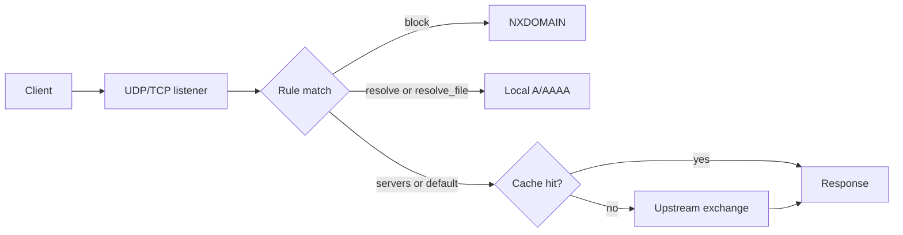

<div align="center">

  <h1>DNSway</h1>

  <p>
    <strong>A lightweight DNS forwarding proxy for rules, caching, and multiple upstreams.</strong>
  </p>

  <p>
    Route queries to the right resolver, block domains, serve local records, and keep using ordinary DNS clients — without running a full recursive server.
  </p>

  <p>
    
    
    
  </p>

  <p>
    
    
    
  </p>

  <p>
    <a href="#features">Features</a>
    ·
    <a href="#configuration">Configuration</a>
    ·
    <a href="docs/configuration.md">Configuration reference</a>
    ·
    <a href="#running">Running</a>
    ·
    <a href="#troubleshooting">Troubleshooting</a>
  </p>

</div>

## Features

DNSway is built around one principle: **the first matching rule is the only rule that applies.** Routing is explicit and ordered; blocked and local answers never reach an upstream; and every query log names the rule that handled it.

**Routing**

- **Ordered first-match rules.** Apply block, static address, hosts, or upstream routing rules from top to bottom.
- **Wildcard domains.** `*.example.com` matches both `example.com` and every subdomain.
- **Local records.** Return `A` and `AAAA` answers from inline addresses or hosts files.
- **Domain blocking.** Return `NXDOMAIN` without contacting an upstream.
- **Targeted upstreams.** Send selected domains only to the resolver you choose.

**Performance**

- **Parallel first answer.** With the `first` strategy, query all selected upstreams at once and use the first successful positive response; negative answers are only fallbacks.
- **Bounded cache.** A sharded LRU cache with positive and negative TTL handling.
- **UDP and TCP.** Both transports listen on the same address.
- **Bootstrap resolution.** Resolve hostname-based upstreams through an IP-based bootstrap resolver.

**Operations**

- **Hot reload.** Rule lists and hosts files reload automatically; the cache is cleared after a successful rebuild.
- **Strict validation.** Invalid rules, upstream references, TLS settings, and files fail at startup with a specific error.
- **Simple deployment.** One binary plus a JSON configuration and optional list/hosts files.

**Diagnostics**

- **`-check` mode.** Validate the whole configuration and probe every upstream before starting.
- **Structured query logs.** See the matched rule, action, upstreams, cache state, response code, and latency.
- **Configurable verbosity.** Use `debug`, `info`, `warn`, or `error`.

## Technical Details

| Component | Stack & description |
| --- | --- |
| Listener | Go with `github.com/miekg/dns`; UDP and TCP on the same `host:port` |
| Routing | Ordered first-match rules with exact names and leading `*.` wildcards |
| Local data | Inline addresses, hosts files, and rule-list files |
| Upstreams | UDP, TCP, DoT, and DoH with bootstrap resolution and three selection strategies |
| Cache | Sharded in-memory LRU with positive/negative TTLs and configurable bounds |
| Reload | `fsnotify` with a short debounce; only list and hosts files are watched |
| Diagnostics | `-check`, structured logs, and field-specific configuration errors |
| Tests | Go unit tests covering config, rules, cache, router, server, and upstreams |

### Architecture

DNSway uses a small request pipeline: a client query enters the UDP/TCP listener, the router validates it, applies the first matching rule, and then returns a blocked answer, a local answer, a cached response, or a response from the selected upstreams.



The listener accepts exactly one question per request; anything else receives `FORMERR`. Blocked and local answers are generated directly and never enter the cache. Forwarded queries are cached when the response is cacheable.

The JSON configuration is loaded once at startup. Rule lists and hosts files are watched separately, so address and blocking changes can be applied without a restart.

## Configuration

A minimal configuration looks like this:

```json
{
  "dns": {
    "listen": "127.0.0.1:15353",
    "timeout": "3s",
    "upstreams": {
      "cloudflare": {
        "address": "1.1.1.1:53",
        "protocol": "udp"
      }
    }
  },
  "routing": {
    "default": ["cloudflare"]
  },
  "cache": {
    "enabled": true
  },
  "rules": [
    {
      "match": ["*.doubleclick.net"],
      "block": true
    }
  ]
}
```

This is only a small illustration. The full runnable sample, including lists and hosts files, is [`docs/config.json`](docs/config.json).

For every parameter, rule action, wildcard and list/hosts syntax, upstream protocol, cache behavior, validation rule, and configuration recipe, see [`docs/configuration.md`](docs/configuration.md).

## Running

Run the included example:

```bash
sudo ./dnsway -config config.json
```

On Windows, run the same command from an elevated PowerShell:

```powershell
.\dnsway.exe -config config.json
```

The sample listens on `0.0.0.0:53`. For unprivileged testing, change `dns.listen` in `config.json` to `127.0.0.1:15353`.

### Command-line flags

| Flag | Default | Description |
| --- | --- | --- |
| `-config` | `config.json` | Path to the JSON configuration file |
| `-check` | `false` | Validate the configuration and probe all upstreams, then exit |
| `-log-level` | `info` | `debug`, `info`, `warn`, or `error` |

## Security and Limitations

DNSway is designed for trusted local networks.

- There is no access control, authentication, or rate limiting. Bind it to a trusted interface and use a firewall.
- DoT and DoH certificate verification is always enabled.
- DNSway does not validate DNSSEC and is not a recursive or authoritative resolver.
- The JSON configuration is loaded at startup. Only files referenced by `match_file` and `resolve_file` are hot-reloaded.
- The cache is memory-only and does not survive a restart.
- Local rules synthesize only `A` and `AAAA` answers.
- A request must contain exactly one question; otherwise DNSway returns `FORMERR`.
- `random` and `round_robin` do not retry another upstream after a failure.

## Troubleshooting

### Port 53 permission denied

Run as root or Administrator, or change `dns.listen` to an unprivileged port such as `127.0.0.1:15353` for testing.

### Address already in use

Another DNS server is already bound to the same UDP or TCP port. Stop it or use a different `dns.listen` value.

### `-check` exits with code 1

Inspect the `STATUS`, `PROBES`, and `ERROR` columns. A failing upstream can be caused by network access, firewall rules, an invalid DoH URL, a DoT `server_name` mismatch, or a timeout that is too low.

### Local names return NXDOMAIN

The local DNS server may not know the name. Confirm that the query matches the expected `resolve` or `resolve_file` rule, and inspect the `rule` and `upstreams` fields in the log.

### Configuration changes are not applied

Restart DNSway after editing `config.json`. Only list files and hosts files are reloaded automatically.

### A blocked domain still resolves

Check rule order, wildcard syntax, and whether a more specific rule above it matches first. After changing a watched file, the cache is cleared automatically.

### Relative path errors

Paths in `match_file` and `resolve_file` are relative to the config file directory. Use absolute paths if the files live elsewhere. See [`docs/configuration.md`](docs/configuration.md) for details.
